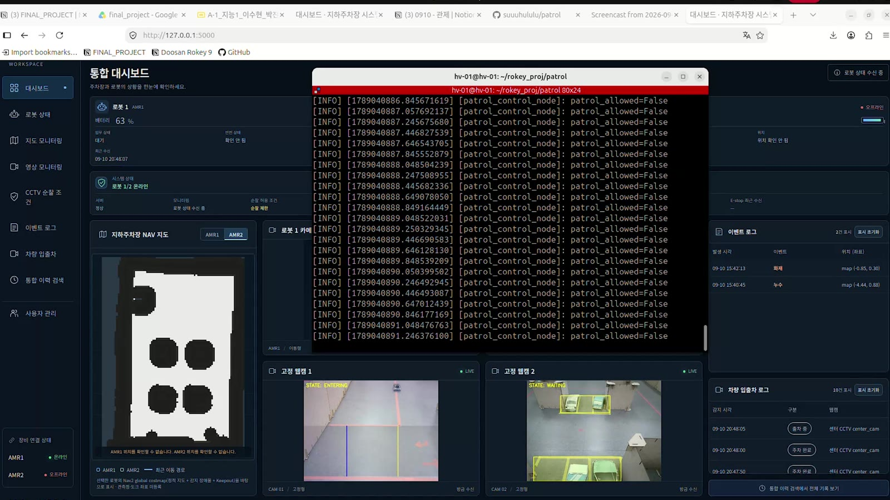
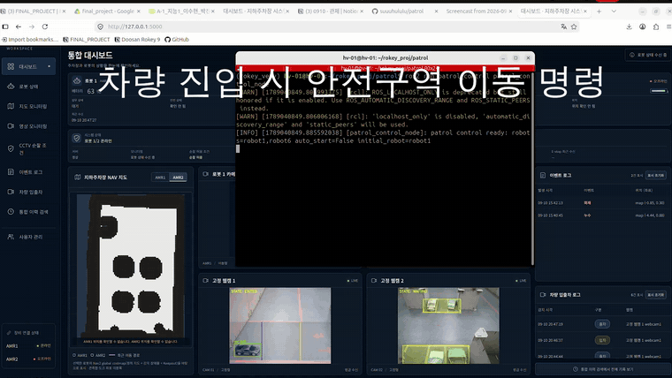
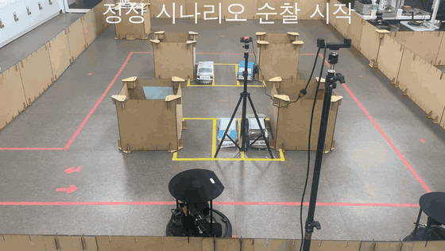
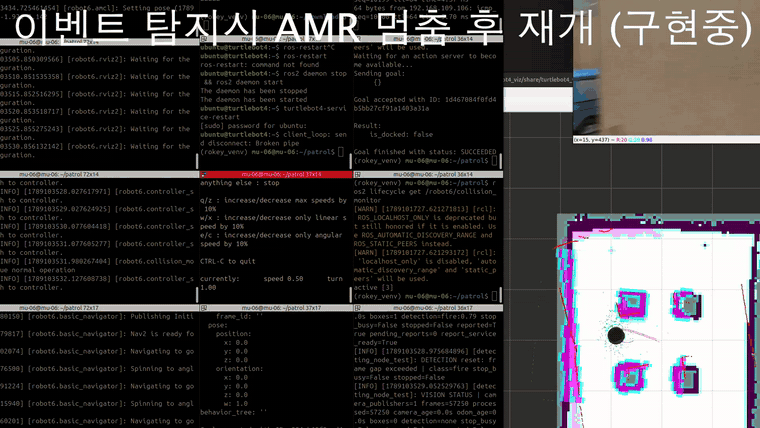
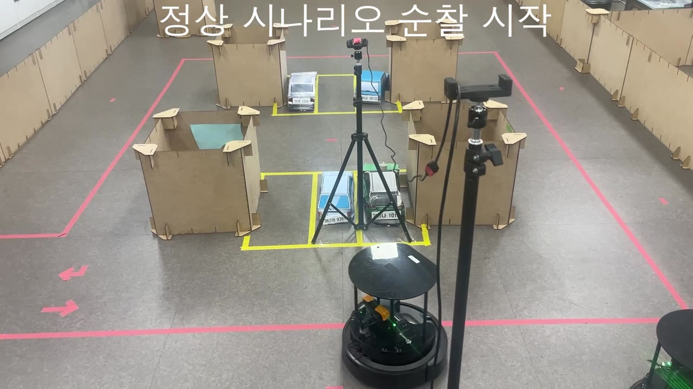
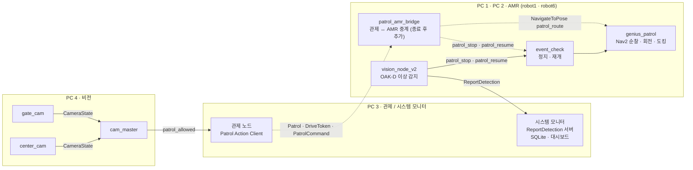

# 🚓 기똥차 — AMR 두 대가 지하주차장을 순찰하고, CCTV로 차량을 보고, 이상을 기록한다

<p align="center">
  
  
  
  
  
  
  
</p>

지하주차장의 화재 · 누수 · 적치물 의심 상황을 **TurtleBot 4가 웨이포인트를 돌며 찾고, 입구 · 주차 구역 CCTV로 차량 움직임을 판정해 순찰 허용 여부를 알리며, 발견한 이상의 종류 · 위치 · 시각 · 이미지를 시스템 모니터에 남깁니다.** 반복 점검의 부담을 줄이고, 이상이 보였을 때 관리자가 판단할 정보까지 전달하는 것이 목표입니다.

> 두산 로보틱스 ROKEY Boot Camp 9기 · 지능-1 "SLAM 기반 자율주행 로봇 시스템 구현" · **기똥차** 팀 — 이수현(PM) · 박진용 · 서동권 · 박성현 · 고희태 · 조정묵 · 이영훈 · 노홍동 · 멘토 Andy Kim (이한혁 중도 포기) · 2026.09.04 ~ 09.11(8일)

## 📑 목차

1. [🎬 데모](#-데모)
2. [💡 한눈에](#-한눈에)
3. [✨ 핵심 기능](#-핵심-기능)
4. [🛠️ 시스템 구조](#️-시스템-구조)
5. [🧩 트러블슈팅](#-트러블슈팅)
6. [📊 결과](#-결과)
7. [🔧 프로젝트 종료 후 보완](#-프로젝트-종료-후-보완)
8. [🌱 배운 점 · 한계](#-배운-점--한계)
9. [👥 팀 · 역할](#-팀--역할)
10. [🤝 개발 · 협업 방식](#-개발--협업-방식)
11. [💻 개발 환경 · 장비](#-개발-환경--장비)
12. [🚀 설치 · 실행](#-설치--실행)
13. [📁 문서](#-문서)
14. [라이선스](#라이선스)

## 🎬 데모

### ▶ 시연 영상

https://github.com/user-attachments/assets/c60197ef-d87e-4d44-82f0-a03078c54a2f

정상 순찰(웨이포인트 이동 · 회전 관측 · 복귀 도킹) → 차량 진입 시 안전구역 이동과 주차 후 재개 → 이벤트 로그 기록과 조회 → 이상 감지 후 정지와 재개 순서로 담은 1분 시연입니다. 기능별 장면(GIF)은 아래 [✨ 핵심 기능](#-핵심-기능)에 있습니다.

### 🖥️ 시스템 모니터 화면

<p align="center">
  <br>
  <sub>통합 대시보드 — 지도 · 로봇 카메라 · CCTV 4분할 영상 · 이벤트와 차량 로그 (가운데는 관제 노드 터미널)</sub>
</p>

<p align="center">
  <br>
  <sub>이벤트 상세 — AMR이 감지한 누수(leak 0.86)의 증적 이미지 · 로봇 · 위치 · 처리 이력</sub>
</p>

## 💡 한눈에

| 문제 | 우리 방법 |
|---|---|
| 지하주차장 화재는 2018년 ~ 2022년 9월 전국 296건, 재산피해 약 291억 원(소방청 국회 제출자료 인용 보도). 초기 확인이 늦으면 피해가 커진다 | AMR이 정해진 웨이포인트를 돌며 제자리 회전으로 주변을 관측하고, 화재 · 누수 · 적치물이 보이면 **그 자리에서 멈추고 증적을 남깁니다** |
| 누수 취약부는 반복 관측과 이력이 있어야 보수 판단을 할 수 있다 | 감지한 사건의 종류 · 위치 · 시각 · 이미지를 **SQLite와 이미지 파일로 저장**하고 이력으로 조회합니다 |
| 차량이 드나드는 공간이라 로봇이 아무 때나 다니면 위험하다 | 입구(Gate) · 주차 구역(Center) 웹캠이 차량 상태를 판정하고, **순찰 허용 여부(`patrol_allowed`)** 로 바꿔 관제에 알립니다 |
| 반복 순찰은 사람의 시간이 많이 든다 | 순찰 · 관측 · 기록은 로봇과 시스템이 하고, 관리자는 **사건 확인과 조치**에 집중합니다 |

```text
[도킹] → 언도킹 → WP1 ~ WP7 이동(각 지점 제자리 360° 회전) → 원점 복귀 → 도킹
감지:  화재 · 누수 · 적치물 확정 → 순찰 정지 → ReportDetection 저장(종류 · 위치 · 시각 · 이미지) → 같은 단계부터 재개
차량:  ENTERING · EXITING → patrol_allowed=false   /   PARKED · EXITED → patrol_allowed=true
```

## ✨ 핵심 기능

### 🚗 CCTV 차량 상태 판정 → 순찰 허용 여부

Gate는 차량 bbox 중심이 **두 판정선을 넘는 순서**로 입차(`ENTERING`) · 출차 완료(`EXITED`)를, Center는 주차 ROI에 **5초 머물면** 주차(`PARKED`), ROI를 벗어나면 출차 시작(`EXITING`)을 판정합니다. 이동 상태는 **0.2초 연속 관측**해야 확정하고, 이벤트 사이에는 **2초 쿨다운**을 둡니다. 차량 1대를 전제로 confidence가 가장 높은 박스 1개만 씁니다([`gate_cam.py`](src/patrol_vision/patrol_vision/gate_cam.py) · [`center_cam.py`](src/patrol_vision/patrol_vision/center_cam.py)).

`cam_master`는 카메라별로 허용된 상태인지, confidence가 0 ~ 1 범위인지, 중복 · 역순 이벤트가 아닌지를 모두 통과한 이벤트로만 `patrol_allowed`를 바꿉니다. 이벤트가 끊겨도 임의로 값을 바꾸지 않고 마지막 값을 유지하며 **5 Hz로 반복 발행**합니다([`cam_master.py`](src/patrol_vision/patrol_vision/cam_master.py)).

| 차량 상태 | 판정 카메라 | `patrol_allowed` |
|---|---|---|
| `ENTERING` 입차 중 | Gate | `false` (순찰 중지) |
| `PARKED` 주차 완료 | Center | `true` (순찰 재개) |
| `EXITING` 출차 중 | Center | `false` (순찰 중지) |
| `EXITED` 출차 완료 | Gate | `true` (순찰 재개) |

<p align="center">
  <br>
  <sub>차량 진입 → 안전구역 이동 명령, 주차 완료 → 순찰 재개 명령 (대시보드 · 관제 터미널, 3배속)</sub>
</p>

### 🤖 AMR 순찰 — 웨이포인트 이동과 회전 관측

TurtleBot 4 Navigator와 Nav2로 도킹 상태에서 출발해 언도킹 → **WP1 ~ WP6 → WP3 재방문 → WP7 → 원점** 순으로 이동하고 다시 도킹합니다. 각 웨이포인트에서는 **제자리 360° 회전**으로 주변을 관측합니다. 순찰은 로봇별 Action 서버(`/{robot}/patrol_action`)에 목표를 보내면 시작합니다([`genius_patrol.py`](src/patrol_amr_safety/patrol_amr_safety/genius_patrol.py)).

<p align="center">
  <br>
  <sub>순찰 시작 → 웨이포인트 이동과 제자리 회전 → 도킹 스테이션 복귀 (4배속)</sub>
</p>

### 🔥 이상 감지 → 정지 → 증적 저장 → 재개

AMR의 OAK-D 카메라 영상을 YOLO11n(화재 · 누수 · 적치물)으로 보고, confidence 0.70 이상이 **1초 동안 이어지면** 사건으로 확정합니다. 확정되면 순찰 정지 서비스(`/{robot}/patrol_stop`)로 그 자리에 멈추고, 종류 · 위치 · 시각 · 이미지를 **`ReportDetection` 서비스로 시스템 모니터에 저장**한 뒤, 저장이 성공하면 재개 토픽(`/{robot}/patrol_resume`)으로 **멈췄던 단계부터** 순찰을 이어 갑니다([`vision_node_v2.py`](src/patrol_amr_safety/patrol_amr_safety/vision_node_v2.py) · [`event_check.py`](src/patrol_amr_safety/patrol_amr_safety/event_check.py)).

<p align="center">
  <br>
  <sub>이벤트 감지 → 순찰 정지 → 재개 (터미널 로그 · 지도, 1.5배속 · 부분 통합 시연)</sub>
</p>

### 🛟 차량 대응 — 정지와 재개

[`move_to_safetyzone.py`](src/patrol_amr_safety/patrol_amr_safety/move_to_safetyzone.py)에는 안전구역 이동 명령(`/{robot}/safety_command`, 1 = 안전구역 이동 · 2 = 순찰 재개)을 받아 가까운 안전구역으로 대피했다가 대피 전 단계부터 재개하는 기능(`PATROLLING → EVACUATING → WAITING`)이 있습니다. 다만 최종 `genius_patrol`은 정지 · 재개(`event_check`)와 함께 실행되도록 묶여 있어, 이 구성에서는 `safety_command`를 구독하지 않고 **그 자리 정지 → 재개**로 동작합니다. 관제의 차량 대응 명령도 [관제 ↔ AMR 중계](#-프로젝트-종료-후-보완)를 거쳐 같은 정지 · 재개로 연결됩니다.

### 🎛️ 관제 노드

관제는 로봇별 순찰 목표 전송(`Patrol` Action Client), 주행 권한(`DriveToken`), 실행 중 명령(`PatrolCommand`)을 담당하고, `patrol_allowed`가 바뀌면 순찰 중지 · 재개 명령을 냅니다([`patrol_control_node.py`](src/patrol_control/patrol_control/patrol_control_node.py)). 관제와 AMR은 프로젝트 기간에는 직접 연결되지 않았고, 종료 후 [중계 노드](#-프로젝트-종료-후-보완)를 더해 연결했습니다.

### 🖥️ 시스템 모니터

로봇 상태 · 차량 로그 · 감지 사건과 증적 · 순찰 이력을 **SQLite와 이미지 파일**로 저장하고, 읽기 전용 대시보드(지도 · 4분할 영상 · 최근 로그)와 이력 조회를 제공합니다. `ReportDetection` 서비스 서버를 맡고, 로그인 · 세션 · CSRF와 서버 측 권한 검사로 관리자 기능을 보호합니다([`src/patrol_sysmon`](src/patrol_sysmon/README.md)).

## 🛠️ 시스템 구조

### 아키텍처

PC 4대, TurtleBot 4 두 대, 웹캠 두 대로 구성합니다. 개발한 팀과 실제로 실행되는 장비를 구분합니다(비전팀의 AMR 감지 노드는 각 AMR PC에서 실행).

<p align="center">
  <br>
  <sub>시연 환경 — 순찰 경로(분홍 선) · 주차 구역(노란 선) · 웹캠 삼각대 · RC 카 · 도킹 스테이션의 TurtleBot 4</sub>
</p>



<sub>실선은 프로젝트 최종 코드에서 연결된 흐름, 점선은 프로젝트 종료 후 중계 노드로 연결한 흐름입니다(빌드 · 정적 검사 · 모의 시험 통과, 실기 미검증 — [프로젝트 종료 후 보완](#-프로젝트-종료-후-보완) 참고).</sub>

| PC | 역할 | 실행하는 것 | 담당 |
|---|---|---|---|
| PC 1 | AMR1 제어 (`robot1`) | 순찰 · 정지 · 재개, AMR 감지, (종료 후 추가) 관제 중계 | 조정묵 |
| PC 2 | AMR2 제어 (`robot6`) | 순찰 · 정지 · 재개, (종료 후 추가) 관제 중계 | 박성현 |
| PC 3 | 관제 · 시스템 모니터 | 관제 노드, 시스템 모니터(저장 · 대시보드 · `ReportDetection` 서버) | 고희태 · 노홍동 · 이영훈 |
| PC 4 | 비전 | `gate_cam` · `center_cam` · `cam_master` | 박진용 · 서동권 |

모든 PC는 `ROS_DOMAIN_ID=6`, 공통 `map` 좌표계, Fast DDS Discovery Server를 씁니다.

### 주요 통신

공용 계약은 `patrol_interfaces 2.0.0`(`Patrol` Action, `CameraState` · `DriveToken` · `PatrolCommand` 등 메시지, `ReportDetection` 서비스)이며, 기준 문서는 [docs/interfaces.md](docs/interfaces.md)입니다.

| 방식 | 인터페이스 | 송신 → 수신 | 역할 |
|---|---|---|---|
| Topic | `/vision/cctv/gate_event` · `/vision/cctv/center_event` (`CameraState`) | gate_cam · center_cam → cam_master | 차량 상태 이벤트 |
| Topic | `/vision/cctv/patrol_allowed` (`Bool`) | cam_master → 관제 | 순찰 허용 여부(5 Hz) |
| Action | `/{robot}/patrol_action` (`Patrol`) | 관제 → 중계 | 순찰 시작 · 진행 · 결과 |
| Topic | `/{robot}/drive_token` · `/{robot}/patrol_command` | 관제 → 중계 | 주행 권한 · 실행 중 명령 |
| Action | `/{robot}/patrol_route` (`NavigateToPose`) | 중계 → AMR 순찰 | 고정 순찰 경로 실행(`genius_patrol`의 `patrol_action`을 remap) |
| Service | `/{robot}/patrol_stop` (`SetBool`) | AMR 감지 · 중계 → AMR 순찰 | 감지 확정 · 차량 대응 · 권한 회수 시 현재 위치 정지 |
| Topic | `/{robot}/patrol_resume` (`Bool`) | AMR 감지 · 중계 → AMR 순찰 | 증적 저장 후 · 차량 대응 해제 시 순찰 재개 |
| Service | `/system_monitor/report_detection` (`ReportDetection`) | AMR 감지 → 시스템 모니터 | 확정 사건과 증적 이미지 저장 |

### 동작 흐름

```text
① 시작     순찰 목표를 받으면 언도킹 후 WP1부터 이동
② 관측     각 웨이포인트에서 제자리 360° 회전
③ 감지     화재 · 누수 · 적치물이 1초 이어지면 정지 → ReportDetection 저장 → 저장 성공 시 같은 단계부터 재개
④ 차량     patrol_allowed=false → 관제 PatrolCommand(1) → 중계 → 그 자리 정지 / true → PatrolCommand(2) → 재개
⑤ 종료     WP7 이후 원점 복귀 → 도킹
CCTV       ENTERING · EXITING → patrol_allowed=false   /   PARKED · EXITED → patrol_allowed=true (관제가 수신)
```

<details>
<summary>설계 대비 구현 상태</summary>

설계 문서는 관제가 `Patrol` Action과 `DriveToken`으로 두 AMR을 교대시키는 구조를 목표로 했습니다. 프로젝트 최종 코드와 종료 후 보완 상태는 아래와 같습니다.

| 설계 | 프로젝트 최종 코드 | 종료 후 보완 |
|---|---|---|
| 관제 → AMR `Patrol` Action으로 순찰 지시 | 관제는 `patrol_interfaces/Patrol` 타입으로 요청하고, AMR은 같은 이름의 서버를 `nav2_msgs/NavigateToPose` 타입으로 열어 직접 연결되지 않음 | 중계가 `Patrol` 서버를 열고 `genius_patrol`(`patrol_route`로 remap)에 `NavigateToPose` 목표를 전달 |
| `DriveToken`으로 한 번에 한 대만 주행 | 관제는 발행하지만 AMR 순찰 코드는 구독하지 않음 | 중계가 토큰을 받기 전에는 순찰을 시작하지 않고, 회수 · 만료 시 정지 |
| 차량 이동 시 관제가 대피 · 재개 지시 | 관제는 `PatrolCommand`를 발행하지만 AMR은 받지 않음(최종 `genius_patrol`은 `safety_command`도 구독하지 않음) | 중계가 `PatrolCommand` 1을 그 자리 정지, 2를 재개로 연결(안전구역 이동은 아님) |
| 감지 · 증적 · 재개 | 구현 — AMR 감지 → 정지 → `ReportDetection` 저장 → 재개 | 그대로 |
| CCTV → `patrol_allowed` | 구현 | 그대로 |

</details>

## 🧩 트러블슈팅

| 문제 | 원인 | 어떻게 해결했나 | 결과 |
|---|---|---|---|
| AMR 통합이 늦어져 전체 일정이 밀림 | 순찰 명령과 감지 결과를 여러 Topic으로 나눠 보내 팀 간 계약이 계속 바뀜 | 하나의 작업으로 볼 기능은 Action · Service로 묶고, 계속 갱신되는 정보(`DriveToken`, CCTV 상태)만 Topic으로 남겨 `patrol_interfaces 2.0.0`으로 정리 | 4개 팀이 같은 인터페이스 패키지를 빌드하고 해시로 일치를 확인 |
| 차량 일부가 ROI 밖에 있어도 주차로 판정될 수 있음 | Center가 bbox **중심점**이 ROI 안인지만 봄 | 발표에서 bbox 전체가 ROI 안에 5초 머물 때 주차로 보는 개선안을 정리 | 코드에는 중심점 기준이 남아 있음([한계](#-배운-점--한계) 참고) |
| 대시보드가 길어지고 영상이 작아짐, 로그가 늘면 배치가 흔들림 | 정보를 세로로 나열한 화면 구조 | 상단 상태 요약 + 하단 지도 · 4분할 영상 · 최근 로그, 로그 영역 내부 스크롤, 화면 폭에 따라 3열 → 2열 → 1열 | 현재 상태와 현장을 한 화면에서 확인 |
| 누구나 관리자 기능에 접근할 수 있음 | 대시보드에 인증이 없음 | 로그인 · 세션 · CSRF와 서버 측 권한 검사, 관리자 계정은 명령으로만 생성 | 관리자 기능 접근 제한 |

## 📊 결과

<p align="center">
  
  
  
</p>

| 항목 | 결과 | 근거 |
|---|---|---|
| 정상 순찰 · 도킹 | WP1 ~ WP7 이동 후 복귀 · 도킹 | 시연 영상 |
| 안전구역 이동과 재개(시연) | 순찰 중단 → 안전구역 대기 → 재개 | 시연 영상 · 터미널 로그(최종 `genius_patrol` 구성은 그 자리 정지 · 재개) |
| 이상 감지와 기록 | 순찰 중 화재 감지 → 정지 → 시스템 모니터 로그 · 이미지 | 시연 영상(부분 통합) |
| 차량 입출차 탐지 | 관제 + 비전 + 시스템 모니터 통합 | 시연 영상 |
| 차량 검출 모델 | YOLO11n · Test P 0.987 · R 0.988 · mAP50-95 0.696 (yolov8n · yolo11n · yolo26n 중 Recall 우선 선정) | [차량 모델 선정 보고서](data/car_data/latest_model_selection_report.md) |
| 이상 감지 모델 | YOLO11n · Test P 0.967 · R 0.997 · mAP50-95 0.700 (후보 6종 중 화재 · 누수 Recall 우선 선정) | [감지 모델 선정 보고서](data/detection_data/latest_model_selection_report.md) |
| 시스템 모니터 단위 시험 | 123개 중 **122개 통과** · 6개 건너뜀 · 1개 실패(시험이 예전 영상 토픽 이름을 기대) | `src/patrol_sysmon/tests` |
| 전체 AMR 종단 통합시험 | **미실시** | 부분 통합까지 검증 |
| 관제 ↔ AMR 중계(종료 후 추가) | 빌드 · flake8 · pep257 통과, 단위 · 모의 통합 시험 **25개 통과**, 실제 관제 노드와 모의 AMR 연동 확인 · **실기 미검증** | [프로젝트 종료 후 보완](#-프로젝트-종료-후-보완) |

차량 모델의 최종 적용본은 시연 환경 이미지를 더해 다시 학습한 `car_best_v2`입니다. 모델 성능은 Colab 기준이며 로봇 연산 장치의 실시간 성능과는 구분합니다.

## 🔧 프로젝트 종료 후 보완

프로젝트 기간에는 관제의 `Patrol` 요청과 AMR 순찰 서버의 Action 타입이 달라 관제와 AMR이 직접 연결되지 않았습니다. 종료 후 기존 코드는 그대로 두고, 둘 사이에 **중계 노드 [`patrol_amr_bridge`](src/patrol_amr_bridge/README.md)** 를 새 패키지로 더했습니다.

```text
관제 ── Patrol Goal ──▶ 중계: 수락 → WAITING_FOR_TOKEN 피드백
관제 ── DriveToken ───▶ 중계: 토큰 확인 → genius_patrol에 NavigateToPose(patrol_route) 전달 → PATROLLING
관제 ── PatrolCommand ▶ 중계: 1 → patrol_stop(그 자리 정지) · BLOCKED / 2 → patrol_resume(재개) · RESUMING
토큰 회수 · 만료(lease) → 정지, 다시 부여 → 재개      Goal 취소 → 정지 후 CANCELED
genius_patrol 완료(도킹) → SUCCEEDED / 실패 → FAILED(NAVIGATION_FAILED)
```

| 검증 | 결과 |
|---|---|
| `colcon build` (`patrol_interfaces` · `patrol_control` · `patrol_amr_bridge`, ROS 2 Jazzy) | 통과 |
| `ament_flake8` · `ament_pep257` | 통과 |
| 단위 시험(중계 판단 로직 16개) · rclpy 모의 통합 시험(7개) · 린트 시험(2개) | **25개 통과** |
| 실제 `patrol_control_node` + 중계 + 모의 AMR(같은 이름의 `patrol_route` · `patrol_stop` · `patrol_resume`) | 자동 시작 → 토큰 부여 → 차량 진입 정지 → 재개 → `SUCCEEDED` 확인 |
| `genius_patrol`과 같은 초기화 방식에서 `-r patrol_action:=patrol_route` remap | `/{robot}/patrol_route`로 열리는 것 확인 |
| TurtleBot 4 실기 종단 시험 | **미실시** |

## 🌱 배운 점 · 한계

**배운 점**

- **상태의 이름뿐 아니라 발생 조건과 판단 주체까지 합의해야 합니다.** 같은 "정지"라도 누가, 어떤 조건에서 내리는지 정하지 않으면 팀마다 다르게 구현됐습니다.
- **진척은 실제 실행 결과로 확인해야 합니다.** 실행 로그 · 영상 · 저장 이력으로 진척을 보고, 막힌 조건은 바로 공유해 업무를 나누고 경험자가 지원하는 방식으로 바꿨습니다.
- 단위 개발 → 부분 통합 → 전체 통합마다 통과 기준과 증거(실행 로그 · 양쪽 연결 로그 · 영상과 결과 이력)를 정해 두는 것이 필요했습니다.

**한계**

- **프로젝트 기간에 전체 AMR 종단 통합은 하지 못했습니다.** 관제의 `Patrol` 요청과 AMR 순찰 서버의 Action 타입이 달라 직접 연결되지 않았고, AMR은 `DriveToken`을 쓰지 않았습니다. 종료 후 추가한 중계 노드는 모의 시험까지만 검증했고 실기에서는 확인하지 않았습니다([프로젝트 종료 후 보완](#-프로젝트-종료-후-보완)).
- 최종 `genius_patrol` 구성에서 차량 대응은 그 자리 정지 · 재개이며, `move_to_safetyzone.py`의 안전구역 이동 경로는 쓰이지 않습니다.
- AMR 감지 노드는 `robot1`과 오도메트리(`/robot1/odom`) 좌표를 쓰도록 고정돼 있습니다. `map` 좌표나 `robot6`로 쓰려면 설정을 바꿔야 합니다.
- Center의 주차 판정은 bbox 중심점 기준입니다(발표에서 정리한 bbox 전체 기준은 코드에 반영되지 않음).
- 모델 가중치(`.pt`)는 저장소에 없고, 코드는 개발 PC의 절대경로에서 가중치를 읽습니다([설치 · 실행](#-설치--실행) 참고).
- 실행 목록(`setup.py`)에 등록됐지만 소스가 없는 노드가 있습니다(`local_safety_supervisor` · `battery_monitor` · `command_gateway` · `status_reporter` · `3_1_c_follow_waypoints` · `mission_supervisor` 등). 루트 `tests/`는 9/10 이전 AMR 구현을 대상으로 한 시험이라 현재 코드로는 실행되지 않습니다.
- 화재 · 누수는 모형 촛불과 색지로 재현했고, 차량은 1대(RC 카) 조건입니다. 순찰 인력시간 40% 절감 같은 사업 지표는 목표치이며 실증하지 않았습니다.

## 👥 팀 · 역할

| 파트 | 담당 | 맡은 것 | 상세 문서 |
|---|---|---|---|
| PM | 이수현 | 요구사항 · 개발 진행 기준 정리, 일정 · 협업 조율 | [scenarios.md](docs/scenarios.md) |
| 비전 | 박진용 · 서동권 | 차량 상태 판정(Gate 선 통과 · Center ROI 체류) · `cam_master`의 `patrol_allowed` 변환 · 카메라 통합, 데이터 학습 · 위험 이벤트 탐지 | [vision.md](docs/vision.md) |
| 관제 · 통합 | 고희태 | 임무 · 주행 권한 관리, 차량 대응 · AMR 선정 · 팀 간 연동 | [control_server.md](docs/control_server.md) |
| AMR | 조정묵 · 박성현 | 주행 · 안전 · 상태 관리, 관측 · 대피 · 재개 · 도킹 | [amr.md](docs/amr.md) |
| 시스템 모니터 | 노홍동 · 이영훈 | ROS 어댑터 · 데이터 저장, 대시보드 표시 · 순찰 이력 조회 | [monitoring_and_data.md](docs/monitoring_and_data.md) |

## 🤝 개발 · 협업 방식

8일 동안 **4개 개발 단위(AMR · 관제 · 비전 · 시스템 모니터)가 `patrol_interfaces` 한 패키지를 공용 계약으로 공유**하며 개발했습니다. 계약을 바꿀 때는 변경 요청서(CR)를 쓰고, 결정은 결정 기록으로 남겼습니다.

<details>
<summary>계약 · 기록 · 브랜치 규칙</summary>

- **공용 계약:** `patrol_interfaces 2.0.0` — 모든 PC가 같은 커밋의 인터페이스 패키지를 빌드하고 해시를 비교합니다. 기준 문서는 [docs/interfaces.md](docs/interfaces.md)입니다.
- **변경 요청서(CR) 10건:** QoS 확정, 정지 서비스 · 재개 토픽, `patrol_interfaces v2` 전환 등 팀 간 계약 변경을 요청 · 승인 단위로 기록했습니다([docs/change_requests](docs/change_requests/README.md)).
- **결정 기록 4건:** 설계 기준선, 관제 인터페이스, AMR 명령 · 임무 계약, 감지 인터페이스([docs/decisions](docs/decisions/)).
- **단계별 통과 기준:** 단위 개발(입출력 · 실패 · 대기 확인, 실행 로그) → 부분 통합(송수신 값 · 필드 · enum 대조, 양쪽 연결 로그) → 전체 통합(순찰 · 중단 · 재개 · 도킹 · 교대 결과, 영상과 이력).
- **브랜치 · PR:** `main`과 짧은 작업 브랜치로 협업하고, 다른 PC와 맞물리는 변경은 PR로 확인받았습니다([branch-guide](docs/development/branch-guide.md) · [pull-request-guide](docs/development/pull-request-guide.md) · [version-control](docs/development/version-control.md)).
- **협업 도구:** Git/GitHub · Notion · Google Drive

</details>

## 💻 개발 환경 · 장비

<details>
<summary>OS · 미들웨어 · 주행 · 비전 · 저장 · 장비 표</summary>

| 항목 | 값 |
|---|---|
| OS · 미들웨어 | Ubuntu 24.04 · ROS 2 Jazzy · Fast DDS(Discovery Server) · `ROS_DOMAIN_ID=6` |
| 주행 | TurtleBot 4 Navigator · Nav2 · AMCL · `map` 좌표계 |
| 비전 | Ultralytics YOLO11n · OpenCV · OAK-D(AMR) · 웹캠(Gate · Center) |
| 저장 · 화면 | Flask · SQLite · 이미지 파일 · 읽기 전용 대시보드(로그인 · 세션) |
| 언어 · 도구 | Python 3.12 · colcon · pytest · Git/GitHub |

| 장비 | 수량 | 용도 |
|---|---|---|
| TurtleBot 4 (OAK-D) | 2 (`robot1` · `robot6`) | 순찰 · 회전 관측 · 이상 감지 · 도킹 |
| 웹캠 | 2 (Gate · Center) | 입출차 · 주차 판정 |
| RC 카 | 1 | 진입 · 주차 시연 차량 |
| PC | 4 | AMR1 · AMR2 · 관제와 시스템 모니터 · 비전 |

</details>

## 🚀 설치 · 실행

로봇 · 카메라 없이 Ubuntu 24.04 PC 한 대에서 **시스템 모니터**를 띄우고 시험해 볼 수 있습니다. 전체 시스템은 TurtleBot 4 2대 · 웹캠 2대 · PC 4대가 필요합니다.

<details>
<summary>빠른 시작 — 시스템 모니터 실행 · 시험 (ROS 불필요)</summary>

```bash
git clone https://github.com/suuuhululu/AMR-patrol-system.git
cd AMR-patrol-system/src/patrol_sysmon
python3 -m venv .venv
.venv/bin/python -m pip install -r requirements.txt
.venv/bin/python -m pytest tests -q              # 122 passed · 1 failed · 6 skipped
.venv/bin/python -m flask --app run create-admin   # 최초 1회 관리자 계정 생성
.venv/bin/python run.py                            # http://127.0.0.1:5000
```

</details>

<details>
<summary><code>CameraState</code> 계약 시험 (ROS 2 Jazzy 필요, 로봇 · 카메라 불필요)</summary>

```bash
source /opt/ros/jazzy/setup.bash
colcon build --packages-select patrol_interfaces patrol_vision
source install/setup.bash
python3 -m pytest src/patrol_vision/test/test_p0_camerastate.py -q   # 2 passed
```

</details>

<details>
<summary>전체 실행 (장비 필요)</summary>

모든 PC에서 같은 커밋으로 `colcon build`하고 `ROS_DOMAIN_ID=6`을 맞춥니다. 기동 순서와 종단 시험은 [docs/integration.md](docs/integration.md), 환경은 [docs/architecture.md](docs/architecture.md)를 따릅니다.

| PC | 명령 |
|---|---|
| PC 4 (비전) | `ros2 launch patrol_vision cctv_cam.launch.py` |
| PC 1 · PC 2 (AMR) | `ros2 run patrol_amr_safety genius_patrol --robot-id robot1` (PC 2는 `robot6`) |
| PC 1 (AMR 감지) | `ros2 run patrol_amr_safety vision_node_v2` (코드에 `robot1`로 고정) |
| PC 3 (관제) | `ros2 run patrol_control patrol_control_node` |

**관제와 연결해 실행(종료 후 추가, 실기 미검증):** AMR 순찰 서버 이름을 `patrol_route`로 바꿔 띄우고, 같은 PC에서 중계를 함께 실행합니다. 관제가 순찰을 직접 시작하려면 `auto_start`를 켭니다.

```bash
# PC 1 (PC 2는 robot1 → robot6)
ros2 run patrol_amr_safety genius_patrol --robot-id robot1 --ros-args -r patrol_action:=patrol_route
ros2 launch patrol_amr_bridge amr_bridge.launch.py robot_id:=robot1
# PC 3
ros2 run patrol_control patrol_control_node --ros-args -p auto_start:=true
```

중계 시험(ROS 2 Jazzy, 로봇 불필요):

```bash
colcon build --packages-select patrol_interfaces patrol_amr_bridge && source install/setup.bash
cd src/patrol_amr_bridge && python3 -m pytest test -q    # 25 passed
```
| PC 3 (시스템 모니터) | 위 빠른 시작의 `run.py` |

**모델 가중치:** 가중치는 저장소에 없습니다. 코드는 아래 절대경로에서 가중치를 읽으므로, 실행할 PC의 같은 경로에 두어야 합니다. 경로의 `patrol/` 아래는 저장소 구조와 같습니다.

| 노드 | 가중치 | 코드가 읽는 경로 |
|---|---|---|
| `gate_cam` · `center_cam` | `car_best_v2.pt` | `/home/hv-06/patrol/data/car_data/car_best_v2.pt` |
| `vision_node_v2` | `detection_best.pt` | `/home/mu-01/patrol/detection_best/detection_best.pt` |

</details>

## 📁 문서

| 문서 | 내용 |
|---|---|
| [`docs/`](docs/README.md) | 문서 지도 — 설계 · 인터페이스 · 시나리오 · 통합 |
| [`docs/interfaces.md`](docs/interfaces.md) | 최종 Action · 메시지 · 서비스 · 토픽 계약 |
| [`docs/architecture.md`](docs/architecture.md) · [`docs/integration.md`](docs/integration.md) | 시스템 구성 · Discovery · 통합 순서와 종단시험 |
| [`docs/amr.md`](docs/amr.md) · [`docs/vision.md`](docs/vision.md) · [`docs/control_server.md`](docs/control_server.md) · [`docs/monitoring_and_data.md`](docs/monitoring_and_data.md) | 개발 단위별 설계 |
| [`docs/change_requests/`](docs/change_requests/README.md) · [`docs/decisions/`](docs/decisions/) | 변경 요청서 10건 · 결정 기록 4건 |
| [`src/patrol_sysmon/README.md`](src/patrol_sysmon/README.md) | 시스템 모니터 실행 · 구성 · 구현 기록 |
| [`src/patrol_amr_bridge/README.md`](src/patrol_amr_bridge/README.md) | 관제 ↔ AMR 중계 — 동작 · 실행 · 시험(종료 후 추가) |
| [`data/`](data/) | 차량 · 이상 감지 모델 선정 보고서 |

<details>
<summary>폴더 구조</summary>

```text
AMR-patrol-system/
├── src/
│   ├── patrol_interfaces/      공용 계약 2.0.0 (Patrol Action · 메시지 6종 · ReportDetection 서비스)
│   ├── patrol_amr_safety/      AMR 순찰(genius_patrol) · 정지/재개(event_check) · 안전구역 이동(최종 구성 미사용) · AMR 감지(vision_node_v2)
│   ├── patrol_amr/             AMR 설정 · 지도 · launch · 시나리오
│   ├── turtlebot4_navigation/  TurtleBot 4 Navigator · Nav2 설정
│   ├── patrol_control/         관제 노드
│   ├── patrol_amr_bridge/      관제 ↔ AMR 중계(프로젝트 종료 후 추가)
│   ├── patrol_vision/          CCTV 차량 비전(gate_cam · center_cam) · cam_master
│   ├── patrol_sysmon/          시스템 모니터(Flask · SQLite · 대시보드 · ROS 어댑터)
│   └── patrol_bringup/         통합 실행 자리(비어 있음)
├── docs/                       설계 · 인터페이스 · 시나리오 · 통합 · CR · 결정 기록 · 플로우차트 · README 이미지(images/)
├── data/                       모델 선정 보고서(car_data · detection_data)
├── maps/                       순찰 지도
├── tests/                      9/10 이전 AMR 구현 대상 시험(현재 코드로는 실행되지 않음)
├── scripts/ · .githooks/       보조 스크립트 · 커밋 훅
└── LICENSE
```

</details>

## 라이선스

[Apache License 2.0](LICENSE) — 각 ROS 2 패키지의 `package.xml` · `setup.py`에 선언된 라이선스입니다. Clearpath Robotics의 TurtleBot 4 예제를 바탕으로 한 파일(`genius_patrol.py` 등)은 원 저작권 표시를 따릅니다.
